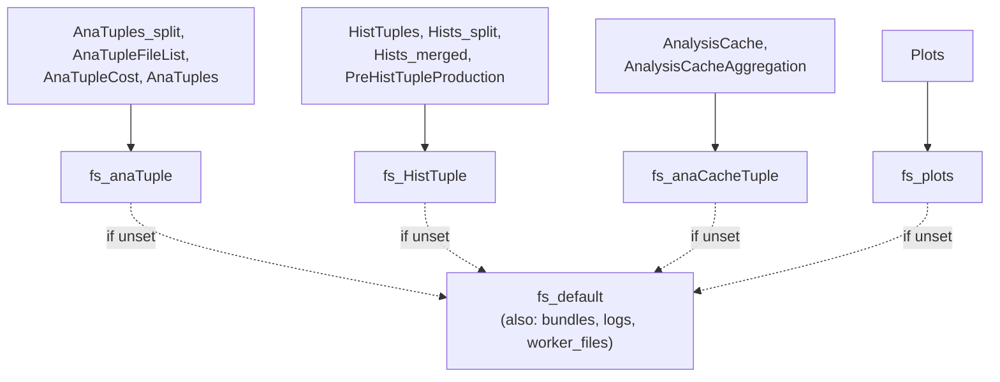
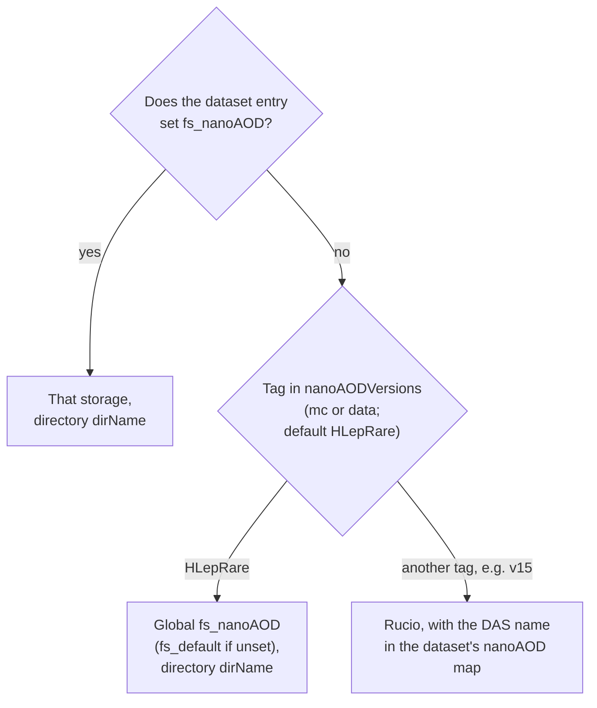

# Storage & filesystems

FLAF reads CMS data from the grid and writes large outputs (ntuples, histograms) to grid/EOS
storage, while keeping small artifacts locally. It abstracts every location behind a **named
filesystem** — a `fs_*` key, normally set in [`user_custom.yaml`](../configuration/user-custom.md).

## Named filesystems (`fs_*`)

Each output type has a filesystem name. You only have to set `fs_default`; the others fall back to
it when unset, so a one-line configuration is enough to get going.

| Key | Used for |
|---|---|
| `fs_default` | The fallback for every key below. **The one key you must set** — a task fails with *No default file system defined* without it. It also directly holds the code bundles, the staged job logs and the bundle jobs' worker files. |
| `fs_anaTuple` | Everything of the AnaTuple production: the per-input-file anaTuples and their reports, the merge plans and reports of `AnaTupleFileListBuilderTask`, the cost probes of `AnaTupleCostProbeTask`, and the merged anaTuples. |
| `fs_HistTuple` | histTuples (ntuples with analysis observables), the per-chunk and the merged **histograms**, and the `PreHistTupleProductionTask` markers. |
| `fs_anaCacheTuple` | The analysis caches (`AnalysisCacheTask`) and their aggregations (`AnalysisCacheAggregationTask`). |
| `fs_plots` | Plot outputs (`HistPlotTask`). |
| `fs_nanoAOD` | An **input** location: where NanoAOD is read from for datasets that are not taken from Rucio — see [Where the inputs come from](#where-the-inputs-come-from). |
| `fs_histograms`, `fs_anaCache`, `fs_nnCacheTuple` | Resolved like the others, but no FLAF task writes to them. `fs_histograms` is used by some analysis studies (e.g. the HH→bb̄WW DNN tasks). |

Official datasets are not reached through a `fs_*` key: FLAF resolves them with a built-in
Rucio filesystem, and there is no `fs_rucio` setting.



!!! tip "Start with just `fs_default`"
    Set `fs_default` to your personal storage and leave the rest unset. Everything then lands in
    one place, namespaced by `--version` and era. Split outputs across sites later, when you need
    to (e.g. point `fs_anaTuple` at a Tier-2/Tier-3 with lots of space).

## How outputs are laid out

Under each filesystem, a product is stored as `<version>/<ProductDir>/…`, in most cases followed
by the era (paths below are relative to `<version>/`):

| Product directory | Written by | Filesystem |
|---|---|---|
| `AnaTuples_split/<era>/<dataset>/` | `AnaTupleFileTask` (`anaTupleFile_<i>.root` + a `.json` report per input file) | `fs_anaTuple` |
| `AnaTupleFileList/<era>/`, `AnaTupleFileList_reports/<era>/` | `AnaTupleFileListBuilderTask` (merge plan and reports, one JSON per dataset) | `fs_anaTuple` |
| `AnaTupleCost/<nano version>/` | `AnaTupleCostProbeTask` (no era: probes are shared by the eras) | `fs_anaTuple` |
| `AnaTuples/<era>/<dataset>/` | `AnaTupleMergeTask` | `fs_anaTuple` |
| `HistTuples/<era>/<dataset>/` | `HistTupleProducerTask` | `fs_HistTuple` |
| `Hists_split/<era>/<variable>/<dataset>/` | `HistFromNtupleProducerTask` | `fs_HistTuple` |
| `Hists_merged/<era>/<variable>/` | `HistMergerTask` | `fs_HistTuple` |
| `PreHistTupleProduction/<era>/<dataset>/` | `PreHistTupleProductionTask` (one `.done` marker per anaTuple file) | `fs_HistTuple` |
| `AnalysisCache/<producer>/<era>/`, `AnalysisCacheAggregation/<producer>/<era>/` | `AnalysisCacheTask`, `AnalysisCacheAggregationTask` | `fs_anaCacheTuple` |
| `Plots/<era>/<variable>/…` | `HistPlotTask` | `fs_plots` |
| `bundles/<era>/` | `BundleTask` (`<flavour>.tar.bz2`, `<flavour>_<hash>.tar.bz2` for a flavour with `hashed: true`, `<flavour>_<FLAF_ENVIRONMENT_ID>.tar.bz2` for the one that packs `flaf_env`) | `fs_default` |
| `logs/<Task>/<era>/` | job logs staged by remote jobs (only for a remote `fs_default`) | `fs_default` |
| `worker_files/<era>/` | input files of bundle HTCondor jobs, uploaded at submission — only when `htcondor_spool` (on by default) is turned off | `fs_default` |

A run over [several eras](eras.md#running-several-eras) writes the same paths: every product above
that carries an era sits where a run over that era alone puts it, so no path holds the set of
eras or a branch number. The output filesystems `fs_anaTuple`, `fs_HistTuple`, `fs_anaCacheTuple` and
`fs_plots` may differ between the eras of such a run (for instance through
`config/<era>/user_custom.yaml`); `fs_default` has to be the same
([user_custom.yaml](../configuration/user-custom.md#several-eras-in-one-run)).

Bundle naming matters when something they pack changes: only flavours with `hashed: true` (in
the analyses: `core`) get a new name, and an existing unhashed bundle (e.g. `soft`, `cmssw`) is
never rebuilt — delete it to force a rebuild. The exception is the bundle that packs `flaf_env`,
named after the environment (`soft_<FLAF_ENVIRONMENT_ID>`), so a rebuilt environment gets a new
one. See
[Bundles](../workflow/htcondor.md#bundles-are-named-after-what-they-contain).

## How to write a location

A filesystem value is a storage URL (or a list of them). Two common forms:

```yaml
# EOS via WebDAV (your CERNBox / EOS user area):
fs_default: davs://eoshome-k.cern.ch:8444/eos/user/k/kandroso/FLAF/HH_bbtautau/

# A WLCG site (Tier-3/Tier-2) by its name + logical path:
fs_anaTuple: T3_CH_CERNBOX:/store/user/<user>/HH_bbtautau/
```

- `davs://…` is a direct WebDAV endpoint (good for your EOS user area).
- `T3_CH_CERNBOX:/store/...` names a registered WLCG site and a logical path under it; FLAF
  resolves it to a physical URL through Rucio and caches the result (see
  [Troubleshooting](../troubleshooting.md#a-run-unexpectedly-drops-into-inputfiletask-rucio-errors)).
  `T3_CH_CERNBOX` (CERNBox) and `T3_US_FNALLPC` (FNAL LPC) are common choices.
- A **local absolute path** (e.g. `/builds/.../output/HH_bbtautau`) is also valid — CI uses one so
  its outputs stay on the runner. Bundle jobs and [`--workflow crab`](../workflow/crab.md) refuse a
  local `fs_default`: they need a remote one.

A value may also be a **list**. The first entry decides whether it is a local or a remote
filesystem. For a local path only that first entry is used; for remote entries every write goes
to **all** of them (mirrors), a read tries them in order until one copy succeeds, and an
existence check or a directory listing asks a single entry, picked at random.

## Where the inputs come from

The NanoAOD source is chosen per dataset, when `InputFileTask` lists its files:



- `dirName` defaults to the dataset name.
- `nanoAODVersions` is a global setting with a `data` and an `mc` tag. When an era does not set
  it, the tag is `HLepRare` and the files are read from the global `fs_nanoAOD`. FLAF sets that
  key for `Run3_2022` … `Run3_2023BPix` to the HLepRare skims
  (`T2_CH_CERN:/store/group/phys_higgs/HLepRare/skim_2025_v1/<era>`), so an analysis that does not
  set `nanoAODVersions` for those eras (HH→bb̄ττ) reads the skims, not the central NanoAOD.
- Any other tag selects the Rucio path: the dataset's `nanoAOD` entry for that tag is the DAS name.
  A dataset without an entry for the tag fails with *Unable to identify the file source*.
- A per-dataset `fs_nanoAOD` is the way to read a **custom** sample from your own storage (see
  [Datasets](../configuration/datasets.md)).

A job that reads a Rucio file copies it to its working directory first (`RunKit/grid_tools.py`,
`copy_remote_file`). It asks Rucio for the disk replicas with their size and adler32 and tries
the nearest site first (sites at the same distance in random order), one endpoint per site before
a second endpoint of a site already tried, and the CMS xrootd federation
(`cms-xrd-global.cern.ch`) after every site:

- each attempt is a single `xrdcp`/`gfal-copy`. It is stopped when it fails, when no data has
  arrived for 5 min, or at a time limit that follows the file size (5 min, or the time the file
  takes at 1 MB/s if that is longer); the next replica is then tried at once;
- an attempt still running after the time the file should take (1 min plus the time at 10 MB/s)
  is joined by one on the next replica, unless data keeps arriving at a rate that brings the
  rest of the file within that time again; at most two copies run at once, the first copy with
  the size and adler32 recorded in Rucio wins, and the other one is stopped;
- every replica is tried up to three more times, 10, 20 and 30 s after its previous attempt
  ended, each time with three times longer limits except the 5 min without data (at most 4 h
  per attempt), so a slow but working connection still gets through; the copy gives up after
  6 h in total;
- a site that failed, or was overtaken after its expected time, is tried after the others for
  the rest of the job (a job copies the input files of all its branches).

So a site that accepts connections but never delivers delays a copy by the time the file should
take (about a minute for a small file), not hours.

## Local working area: `data/`

Independently of the `fs_*` storage, each analysis checkout has a `data/` directory
(`$ANALYSIS_DATA_PATH`, default `<analysis>/data`) used for:

- your **VOMS proxy** (`data/voms.proxy`, where `X509_USER_PROXY` points by default),
- LAW job files (`data/jobs/`),
- small local outputs under `data/<version>/<Task>/<era>/` — e.g. the input file lists of
  `InputFileTask` and the per-dataset copies of `AnaTupleFileListTask` — and the AnaTuple cost
  model (`data/<version>/AnaTupleCost/cost_model.json`).

This lives in your AFS checkout, not on grid storage.

## The VOMS proxy is your storage key

All grid/EOS access uses your **VOMS proxy**. If it expires, reads and writes to `fs_*` locations
fail — often with confusing "permission denied" or "file not found" messages. Refresh it with
`voms-proxy-init -voms cms -rfc -valid 192:00` (see [Installation](../getting-started/installation.md)).

## A caveat worth knowing: read-after-write lag on EOS

EOS is eventually consistent. A file you just **wrote** can be briefly **invisible** to a
subsequent existence check (seconds, occasionally longer). FLAF tolerates this in normal
operation, but if you script your own existence checks against freshly written outputs, probe with
a directory listing and a short retry rather than a single `exists()`. See
[Troubleshooting](../troubleshooting.md#eos-read-after-write-lag).

## How uploads are published and absence is decided

These hold for remote (gfal/WLCG) storage, on every backend (local, HTCondor and CRAB). An
`fs_*` given as a local path (starting with `/`) is written directly by law, without a
temporary name or checksum.

- **Uploads are published by rename.** A local file is first uploaded to
  `<target>.flaf-tmp-<pid>-<uuid>` next to its destination, verified by checksum, and only then
  renamed onto the target. The target therefore never exists while partial, and an existing good
  file is not removed before its replacement is complete. An upload whose last attempt fails
  removes its temporary file; a killed one can leave an orphaned `.flaf-tmp-*` file behind. Such
  a file is matched by no output pattern (its name does not end in `.root`), but it takes quota
  until it is deleted. A storage that refuses to rename onto an existing name keeps an
  identical target and drops the upload, or removes a different target and renames again.
- **A failed listing is not an absence.** A `gfal-ls` that times out, fails SSL or lacks a
  credential is retried, and then reported as a failure. Only a listing that gfal itself reports
  as *not found* (errno `ENOENT`) means that a path is absent, and only that is cached — in the
  process and on the path-cache server, where a wrong negative would hide existing files from
  every client. `exists()` answers `False` for a listing that failed, but caches nothing: the
  next lookup lists again, so once the storage answers, the rest of the directory is judged on a
  real listing. The failure is reported once per directory per minute. Each listing attempt is
  limited to 5 minutes.
- Listings are taken with `TZ=UTC`, so the dates in them do not depend on the host.

On both batch backends the driver takes a fresh listing before it accepts an "absent" answer for a
job reported finished, since jobs publish nothing to the path cache
([CRAB → Status handling](../workflow/crab.md#status-handling)). On both batch backends a
workflow that starts to run gathers its existing outputs again on fresh listings
([HTCondor → Submission safeguards](../workflow/htcondor.md#submission-safeguards)).

## Keeping I/O off shared production areas

When testing, point `fs_default` at *your own* area (and use a personal `--version`) so you never
write into a shared production path. The CI does the inverse — it points `fs_default` at the local
runner so a test never touches real storage at all.

## Locking a finished production

FNAL EOS keeps no backup and no recycle bin: a deleted file is gone. In a group area such as
`/store/user/lpcflaf` every member may delete and overwrite every file, and a re-run with the same
`--version`, a `--remove-output` reaching a central production through `--ana-version`, or a stray
`eos rm -r` can destroy a finished production. `run_tools/eos_lock.py` makes a finished folder
read-only:

```bash
python3 FLAF/run_tools/eos_lock.py status /eos/uscms/store/user/lpcflaf/HH_bbWW/v2610/AnaTuples/Run3_2022
python3 FLAF/run_tools/eos_lock.py lock   /eos/uscms/store/user/lpcflaf/HH_bbWW/v2610/AnaTuples/Run3_2022           # the plan
python3 FLAF/run_tools/eos_lock.py lock   /eos/uscms/store/user/lpcflaf/HH_bbWW/v2610/AnaTuples/Run3_2022 --apply   # the lock
python3 FLAF/run_tools/eos_lock.py unlock /eos/uscms/store/user/lpcflaf/HH_bbWW/v2610/AnaTuples/Run3_2022 --apply
```

The folder is given as an EOS path on `--mgm` (default `root://cmseos.fnal.gov`) or as a
`root://host//eos/...` URL. Without `--apply` nothing is changed. The script needs the `eos`, `xrdfs`
and `xrdcp` clients (lxplus, cmslpc) and a valid grid proxy; it uses only the Python standard
library.

**What a locked folder is.** Every directory and file belongs to the user who locked it, every
directory has mode `0555` and `sys.acl="g:5063:rx,u:<locker>:A,z:i"` (`--admin <uid>`, repeatable,
adds users allowed to change the ACL). `z:i` makes each directory immutable for everybody, its owner
included: over xrootd, davs and the eos CLI no file can be created, overwritten, updated, deleted or
renamed and no directory created or removed, while reading is unaffected. A job that writes into a
locked folder fails with `directory immutable` (xrootd) or `HTTP 403 : Permission refused` (davs).

**Why the lock takes ownership.** The owner of a directory may always change its ACL, and the owner
of a file may give that file an ACL of its own, so a folder that still belongs to its producer can be
unlocked by one command. A member cannot `chown` the files of other members (that takes a `c` rule
in the directory's ACL, which the lpcflaf template does not give), but the lpcflaf member ACL lets a
member create, rename and delete in directories of other members. The script therefore

- copies a file of another owner next to itself (third-party copy, size and adler32 checked) and
  renames the copy onto the original, after checking the original once more;
- rebuilds a directory of another owner: a new directory next to it receives copies of all its
  files, the original is moved into the new one, the new one is renamed into its place (the *swap*),
  and the subdirectories of the original are moved over before it is removed. Nothing is removed
  from the parent, where a `!d` rule (such as `g:5063:rx!d!u`) forbids removing another member's
  directory even to the parent's owner. The rebuilt directory keeps the original's attributes
  (`sys.forced.*`, ...) except `sys.acl` (the lock sets it), `sys.eos.btime` (its own creation time),
  `sys.owner.auth`, `sys.eval.useracl` and `user.acl` (left out, as they would hand rights to
  somebody else).

An original is deleted only once a copy with the same size and checksum is in place. A file found
changed between its copy and its replacement is not replaced and stops the lock; in a rebuilt
directory, the copy made before the change stays at the path and the changed original is kept in
`<directory>/.flaf-lock-old`, which the lock then refuses to remove. Copying costs transfer time
and, while one directory is rebuilt, quota for its files. The plan printed without `--apply` lists
the files and volume to copy, the extra quota needed at a time, the directories to rebuild (about
20 s each from lxplus, plus their copies) and the largest swap.

**Before locking.** The script refuses a folder in which an upload may still run (a `.flaf-tmp-*`,
`.dsprod-tmp-*` or EOS atomic-upload file, or a file modified in the last `--min-age` minutes, 60
by default), a folder with symlinks, a folder below a locked one or below a lock that is running,
a folder containing a running lock of a subfolder, a directory whose `sys.owner.auth` would hand what
the lock creates to another user, and directories whose ACL does not let the caller rebuild them.
Lock the units that have stopped changing — a dataset's anaTuples, an era of plans once it is final
— rather than a whole version: the parents stay open, so new datasets can still be added next to
locked ones. One run handles at most about 50 000 directories or files (the limit of a non-admin
`eos find`); lock larger folders by subfolder. The script needs Python 3.9 or later (the system
Python of lxplus and cmslpc).

**Interrupting a lock is safe.** Every file stays at its path with its content while the lock runs,
and a job that has a file open keeps reading it to the end even when the lock replaces it. The one
exception is a swap. Between its two renames the directory itself, files included, is missing from
its path for about two requests, longer while the storage does not answer; then its subdirectories
are missing until they are moved back, 16 at a time (200 subdirectories took 10 s from lxplus). Ctrl-C, Ctrl-Z, SIGTERM and SIGHUP never stop
the lock inside a swap: it completes the swap and stops right after it, or before the next one,
with every file in place and exit code 3 (an ignored SIGHUP, as under `nohup`, stays ignored). A
swap whose requests fail is retried as a whole for a few minutes, at once if a stop was requested;
if the storage does not answer by then, the lock stops with an error that says where the missing
entries are (`<directory>/.flaf-lock-old`, or the whole directory in
`<directory>.flaf-lock-new/.flaf-lock-old`), and the next run puts them back before anything else.
Only a hard kill (SIGKILL, a crashed node) inside a swap leaves paths missing without that message.
While a lock runs and after it stops, the directories it has reached accept no writes from other
members; the ACL changes never affect reading.

**Keep the session open while a lock runs.** Ending an lxplus session (logging out, a dropped
connection) sends SIGTERM to the lock and to the copies and renames it runs, and kills whatever is
left 90 s later. The lock then completes a swap under way and stops; the copies under way are lost
(the lock exits with code 1 rather than 3) and the next run redoes them. A swap that has not
completed when the session is killed leaves its subdirectories, or the whole directory, in the
places named above until the next run. Run `status` afterwards: it reports an interrupted lock and a
marker left by a killed one.

**Resuming.** An interrupted lock leaves `*.flaf-lock-new`, `.flaf-lock-old` or `*.flaf-lock-tmp`
entries, and after a hard kill the `<folder>.flaf-lock-running` marker. Remove the marker once no lock
runs (copies the killed run started may still be running; they cannot harm a rerun, which checks
every copy), and run the same command again, as the same user: it first puts back any path a swap
left missing, then resumes where it stopped. If an original was deleted while the lock was
interrupted, the rerun stops instead of promoting a copy it cannot verify, and names the copy to look
at. If something else took the path of a directory during its swap, the lock stops and leaves the
original in `<directory>.flaf-lock-new/.flaf-lock-old` to be resolved by hand.

**What it does not stop.** Renaming the folder's open parent moves the locked folder as a whole; an
empty locked directory can still be removed together with its open parent; the owner (or an `A`
holder) can unlock it deliberately, and root can do anything. Never edit a locked folder's ACL with
`eos acl` — it silently drops `z:i` — and never remove it with `eos attr rm sys.acl`; use `unlock`.
