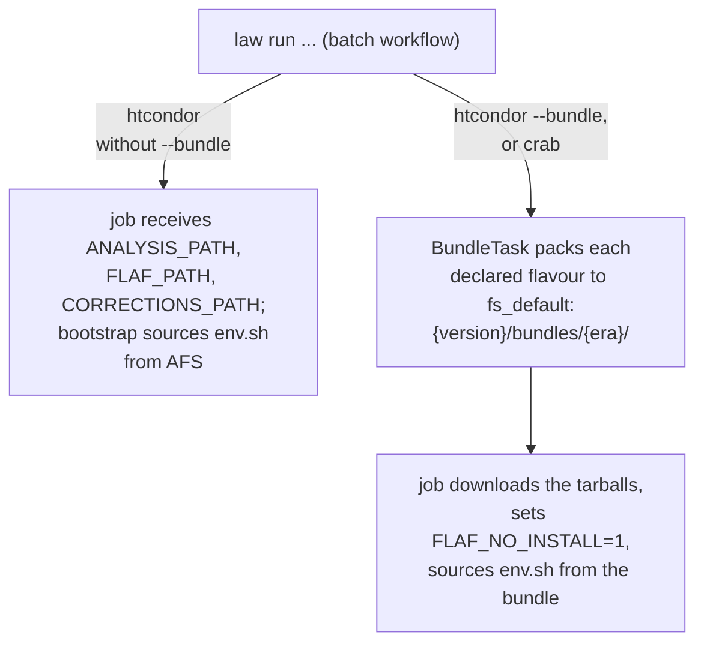

# Running on HTCondor

Producing ntuples and histograms for a full era means processing thousands of files — far too much
for one machine. FLAF tasks are **workflows** ([Tasks & LAW](../concepts/tasks-and-law.md)), so
their branches can be submitted to CERN's **HTCondor** batch system. The recommended pattern is to
**develop and test with `--workflow local`, then switch to `--workflow htcondor` for production** —
the command is otherwise the same.

## Submit a task to the batch system

```sh
law run FLAF.AnaProd.tasks.AnaTupleFileTask \
  --era Run3_2022 --version prod \
  --workflow htcondor \
  --parallel-jobs 100
```

| Option | Why you want it |
|---|---|
| `--workflow htcondor` | Submit branches as batch jobs instead of running locally. |
| `--transfer-logs` | **On by default** (turn off with `--transfer-logs False`). Each job's combined stdout/stderr (`stdall*.txt`) is kept: with a remote `fs_default` the job uploads it to `<version>/logs/<Task>/<era>/` on `fs_default` (plus the producer name for per-producer tasks) as `stdall_<first>To<end>_<cluster>.<proc>.txt` (branches `<first>` to `<end>` − 1; `<cluster>.<proc>` is the HTCondor job id), so every attempt of a resubmitted job keeps its own log, and `--print-status` points there; with a local `fs_default` the log is part of the job's output sandbox: HTCondor copies it back to the task's `data/<version>/<Task>/<era>/` directory only with `--htcondor-spool False`, since with the default `-spool` the sandbox stays on the schedd until `condor_transfer_data` is run (law does not run it). |
| `--parallel-jobs 100` | Cap how many jobs are in flight at once. Be a good citizen on the shared pool; very large uncapped submissions are discouraged. Over [several eras](#several-eras-in-one-submission) it is one cap for the whole run, not one per era. |
| `--branches 0:100` | Submit only a subset (e.g. to retry a range); `start:end` excludes the end, so this is branches 0–99. Over several eras the numbers carry the era ([Command arguments](arguments.md#several-eras-era-and-branches)). |

Other HTCondor parameters available on every workflow task: `--max-runtime`, `--n-cpus`,
`--priority`, `--htcondor-spool`. See [Command arguments](arguments.md).

## How branches become jobs

By default LAW puts a fixed number of consecutive branches into each job (`--tasks-per-job`). That
works when branches cost about the same. AnaTuple production is not like that: a dilepton-skim file
where half the events are selected costs twenty times what a hadronic one does, and because
branches are ordered by dataset the expensive ones are neighbours — so fixed-size chunks collect
them into the same job, which then runs into `--max-runtime`, is removed by HTCondor, and is
retried with exactly the same grouping.

`AnaTupleFileTask` therefore composes jobs by **estimated cost**:

```
seconds(file) = overhead + sec_per_event(dataset) x n_events(file)
```

- `sec_per_event` is measured, not configured — first by [`AnaTupleCostProbeTask`](../reference/tasks.md#anatuplecostprobetask),
  then refined from the durations of the production jobs themselves, which are recorded as they
  finish and used by the next run.
- `n_events` comes from `InputFileTask`'s catalogue, or is inferred from the file size when the
  storage does not report event counts.

Branches are then packed into jobs up to `target_job_hours`, largest first. A file that costs more
than that on its own gets a job to itself; cheap ones are combined until the target is reached.
Where the estimate is a guess rather than a measurement (a dataset the probe could not reach, a new
sample), the packing is deliberately more conservative, so a wrong guess cannot rebuild an
over-long job.

Consequences worth knowing:

- **Each resubmission of a failed job gets more runtime and, if configured, more memory**, up to
  `retry_max_factor`.
- **Jobs are grouped once per run, from everything measured so far**, and never regrouped while
  that run is polling: LAW fixes the total job count when polling starts, so changing it mid-run
  would corrupt its accounting. Durations observed during a run are recorded and applied by the
  *next* one — including a plain resume of the same version, which regroups whatever is still
  unsubmitted before it resumes polling. So restarting is how an over-long group gets broken up,
  and unlike the manual `--tasks-per-job 1` restart it replaces, the regrouping is automatic and
  applies only where the measurements say it is needed. A resume only regroups what is still
  *unsubmitted*, though: a group already recorded in the jobs file comes back with its original
  composition, so use `--ignore-submission` to regroup those as well.
- **A production restarted after some of its files were produced** is packed exactly as a fresh
  one would be, and only the jobs' missing branches are submitted: each job keeps the files it
  would have had that are not produced yet, and no job is created for the rest.
- **`--parallel-jobs` defaults to 2000** for this task, which is good queue hygiene.

Passing `--AnaTupleFileTask-tasks-per-job` (or a bare `--tasks-per-job` when `AnaTupleFileTask` is
the task given to `law run`) turns the cost-aware grouping and the per-attempt escalation off for
that task and restores plain fixed-size chunking — the escape hatch if an estimate ever misbehaves.
Setting the option for a *different* task does not affect it; in particular a bare
`--tasks-per-job` given to `law run AnaTupleMergeTask` applies to `AnaTupleMergeTask` only.

However the branches are grouped, a job runs all of its branches in **one** law process
(`law run <Task> --branches=<list> --workflow=local`, or `--branch=<b>` for a single one), on
HTCondor and CRAB alike. law 0.1.21's own job script would start one process per branch and stop
the job at the first branch that fails, leaving its group-mates undone; FLAF's job script, generated
from law's with only that loop replaced, lets luigi carry on with the other branches, and the job
still fails (exit code 60) if any of them did. It prints no dependency tree on the worker
(`--print-deps=0`).

## Monitor and resume

LAW tracks which branches have finished (by checking their outputs), so a re-run only resubmits the
missing ones — batch jobs fail and time out, and resuming is normal. Check progress with:

```sh
law run FLAF.AnaProd.tasks.AnaTupleFileTask \
  --era Run3_2022 --version prod --workflow htcondor --print-status 1,1
```

Standard `condor_q` / `condor_status` work for the underlying jobs.

## Several eras in one submission

`--era Run3_2022,Run3_2022EE` submits each stage once, for all the eras that still need work at
that stage ([Eras](../concepts/eras.md#running-several-eras)). A stage is one workflow with one
poll loop, but the jobs stay per era:

- **A job never mixes eras.** Each era's jobs are laid out as `--era <that era>` alone would lay
  them out, with the per-task values of the command line (`--tasks-per-job`, `--max-runtime`,
  `--n-cpus`): the cost-based packing of `AnaTupleFileTask` runs per era with that era's
  measurements, and the durations of the finished jobs are recorded per era. A job runs
  `law run <Task> --era <its era> --branches=<the era's own numbers> --workflow=local`, with that
  era's bundles, logs and worker files.
- **`--parallel-jobs` is one cap for the whole run**, all eras together; the jobs of the eras are
  polled in one loop.
- **Each era keeps its own job file**, the file a run over that era alone reads and writes:
  `data/<version>/<Task>/<era>/htcondor_jobs_<branches>.json` (`<branches>` is the range of the
  era's branches, e.g. `0To96`), holding that era's jobs and branches in the era's own numbers.
  A run over several eras and runs over some of its eras therefore pick up each other's jobs, in
  any order:

    | Sequence | What happens |
    |---|---|
    | `--era A` stopped, then `--era A,B` | A's file is loaded: its jobs in flight are polled to the end and its unsubmitted jobs are submitted once. B starts a file of its own. |
    | `--era A,B` stopped, then `--era A` | A resumes from its file as in any run over one era; B's file is untouched. |
    | `--era A,B`, then `--era B,C` | B is resumed, C starts fresh, A is untouched. |
    | A finished, then `--era A,B` | A is pruned: nothing is submitted for it and its file is unchanged. B runs. |
    | The same run restarted | The same files each time; every branch is submitted once. |
    | A `--branches` selection | The files are named as a run over one era with the same selection (in the era's own numbers) names them, in either order. |

- **A change of an era's branch map while its jobs are in flight resubmits them**, as in a run over
  one era: the file name carries the branches of the map, so a map with other branches (datasets
  added or removed, another `--dataset` or `--process` selection) starts a new file, and every
  branch that still lacks an output is submitted, including those still running under the old
  file. Let the jobs finish, or kill them, before changing the lists.
- **Two instances of one stage that share an era never run at once in one `law run`** (a luigi
  resource per job-file directory, `flaf_jobs:<directory>`, of capacity 1 unless luigi's
  `[resources]` configuration section sets another), so the second finds the work of the first
  done. Run **one driver per era**: two separate `law run` processes on the
  same era, from two terminals, do not see each other, exactly as two drivers of one era never
  did.

## Bundles: shipping the code to workers

A batch worker needs your code and environment. FLAF supports two modes:

- **Non-bundle jobs** rely on the shared AFS area being mounted on the worker: the job receives
  `FLAF_PATH`/`CORRECTIONS_PATH` and runs the code straight from AFS (including any edits you made
  via the [dev overlay](../concepts/environment.md#developing-shared-submodules)).
- **Bundle jobs** ship a tarball of the code/environment to the worker (the `--bundle` flag and the
  `BundleTask` machinery). The worker runs from the tarball and never reaches back to AFS, so it is
  deliberately *not* given `FLAF_PATH`/`CORRECTIONS_PATH`. Bundles also set `FLAF_NO_INSTALL=1` so
  the worker never tries to build the environment.



On HTCondor, bundles are used **only with `--bundle`**: without it every job runs from AFS,
whatever `bundle_flavours` the task declares — those only say which tarballs to ship once bundles
are on (AnaTuple production, for example, adds `cmssw` when it runs in CMSSW). Bundles need a
remote `fs_default`. For most work the non-bundle default is correct; use `--bundle` when AFS is
not available on the target pool.

The `patterns` of a flavour (in the analysis `global.yaml`) can use `{era}` and `{version}`. The former
`{period}` is refused with `… use {period}, which was renamed to {era}`; the bundle URI
(`<version>/bundles/<era>/`) is unchanged. Bundles stay per era in a run over several eras: it
requires the bundles of each era that still has work, a missing one is built by the `BundleTask`
of its era, and an existing one is never rebuilt.

### A bundle waits for everything it packs

A flavour that packs the output of a task declares it in `task_requires`, and a flavour that
packs the output of *several* tasks lists all of them:

```yaml
  AnaTupleFileList:
    patterns:
      - data/{version}/AnaTupleFileListBuilderTask/{era}
      - data/{version}/AnaTupleFileListTask/{era}
    task_requires:
      - module: FLAF.AnaProd.tasks
        class: AnaTupleFileListBuilderTask
      - module: FLAF.AnaProd.tasks
        class: AnaTupleFileListTask
```

With only the first one listed the bundle is packed as soon as the builder is done, while the
per-dataset lists of the second are still being written, and the jobs receive a tarball that
is missing them. FLAF warns when a packed `data/<version>/<Task>/<era>` directory has no
matching entry. The producers are requested with the workflow the submission was started
with, so they are the same task instances the rest of the graph waits on.

### Bundles are named after what they contain

A bundle's output is a path, and law treats an existing one as complete forever — so an edit
made after it was first built would never reach the workers, which rebuild their branch map
from the config *inside the tarball*. Adding one dataset shifts every branch index after it,
and jobs then work on a different file than the one they were submitted for.

Flavours therefore opt into a content hash in `global.yaml`:

```yaml
bundles:
  core:            # code and configuration: small, edited often
    hashed: true
    patterns: [ FLAF, AnaProd, Analysis, config, env.sh, Corrections, include ]
  soft:            # the installed environment: large, changes only on a reinstall
    patterns: [ soft/flaf_env ]
```

A hashed flavour is published as `core_<hash>.tar.bz2`, so changing any packed file yields a
new name, `BundleTask` sees a missing output and rebuilds, and the jobs are handed the URL of
the bundle matching the code they were submitted with. Files up to 1 MB are hashed by their
content and larger ones by size and modification time, which keeps the cost at a fraction of
a second per submission even for an analysis shipping ~150 MB of models.

Splitting a big immutable payload into its own unhashed flavour is what keeps it that cheap.
The trade-off is that such a flavour is **not** rebuilt when its content changes: after
reinstalling the environment, or changing anything else packed without a hash, delete the
bundle so that the next submission recreates it — and drop its entry from the path-existence
cache (`pathCacheClient.py --command invalidate`, see [Troubleshooting](../troubleshooting.md)), or `BundleTask` can keep reporting the
deleted file as present. One change is covered without that: the flavour that packs
`flaf_env` (`$FLAF_ENVIRONMENT_PATH`, `soft` in the analyses) is named after the environment,
`soft_<FLAF_ENVIRONMENT_ID>.tar.bz2` (the LCG release and a hash of `run_tools/mk_flaf_env.sh`,
see [The environment](../concepts/environment.md#what-envsh-sets-up)), because the job script and
the wrappers are rendered from the driver's packages and must run against the same ones on the
worker. A change of the installation script, which rebuilds `flaf_env`, therefore rebuilds the
bundle under a new name; the old file can be deleted once no job of the version uses it.

!!! warning "A symlink can send a bundle job back to AFS anyway"
    Symlinks *inside* a packed directory are kept as symlinks — deliberately, so that the CVMFS
    links in `soft/flaf_env` are not dereferenced into the tarball. An absolute symlink pointing
    into the analysis area therefore still resolves to the submit host on the worker, and every
    job reads that payload over AFS. A few thousand jobs pulling a model or a correction file this
    way is enough for CERN to answer with *"Batch submission limited due to high AFS load"*, while
    the jobs themselves fail on timeouts (`DEADLINE_EXCEEDED … Connection timed out`). Reference
    the real content the bundle packs — for HH_bbtautau the HHbtag models are taken from
    `$ANALYSIS_PATH/HHbtag/models`, not through `$CMSSW_BASE/src/HHTools/HHbtag`, which is such a
    symlink.

For jobs that should run on the full CMS WLCG (not only CERN HTCondor), use
[`--workflow crab`](crab.md) — that path always uses bundles.


!!! tip "Your edits to FLAF *do* reach the workers"
    Thanks to the dev overlay, non-bundle jobs run your edited `FLAF`/`Corrections`, and bundle
    jobs include them in the tarball — so testing framework changes on HTCondor works without
    committing first. See [Contributing](../contributing.md).

## Submission safeguards

These apply to both batch backends (HTCondor and [CRAB](crab.md)).

- **An unreadable software tree skips a submission round.** law's own job sources
  (`law_job.sh`, the CRAB and HTCondor wrappers, `PSet.py`) and FLAF's `bootstrap.sh` and
  `stageout_logs.sh` are probed before each submission round. If one cannot be read (an expired
  Kerberos ticket or AFS token, a blinking mount), the round is skipped: nothing is lost, the
  retries offered by law are parked, and the next poll tries again. The message gives the path,
  the errno and a hint (`klist -f` shows the Kerberos expiry and the renewable window, `tokens`
  the AFS token). Skipping for more than 30 minutes raises, and with `--no-poll`, which would
  not submit the round later, it raises at once. `--no-poll` applies to the workflow it is given
  to only: law does not pass it on to the remote workflows that one requires, which are polled to
  completion as usual. One failed `stat` of the software tree cannot
  make law mistake its own module for a directory.
- **Existing outputs are gathered when the workflow starts to run.** law records which branches
  are complete when luigi schedules the workflow; that record is dropped and taken again, with
  absence resting on fresh listings, when the workflow starts to run, so outputs written in
  between (a job that finished while the driver was restarting, a workflow that waited for its
  inputs) are not sent back to the batch system.
- **A resumed workflow that lost its outputs stops.** When a workflow is resumed (its job file
  exists), every job that comes back for missing outputs (a job it had recorded as finished, or a
  live job reported finished without them, which includes a job that finished during the first
  status query) is checked again with absence resting on fresh listings and by the task's own
  completeness rule (so branches whose inputs were merged and replaced by markers, as with
  `HistMergerTask` and `remove_merged_inputs`, count as done). A job whose branches are complete
  is booked as finished, not resubmitted. If more than 10 % of all its jobs — and at least 2 —
  are still missing (over several eras: of an era's jobs, so that the unsubmitted jobs of a fresh
  era do not dilute another era's loss), the run stops
  instead of resubmitting them, and their entries in the job file are put back as they were, so
  a later run judges them again. The usual cause is storage that was unreachable while outputs
  were checked: run again once it is back. To redo the work on purpose, run again with
  `--ignore-submission`.
- **A finished job is believed only when its outputs are on storage.** As on CRAB
  ([CRAB → Status handling](crab.md#status-handling)), the driver never takes the batch system's
  "completed" at its word: at every poll it lists, in parallel, the output directories of the jobs
  reported finished, every "absent" resting on a listing taken in that poll. A job whose outputs
  are on storage is booked finished; one whose outputs are missing is kept running for one more
  poll and retried only if they are still missing then; one whose output directory cannot be
  listed is kept running until it can be, at most 30 minutes after it was reported finished, then
  the run stops and nothing is resubmitted. A held job counts as running, so a workflow cannot
  finish while a job is unconfirmed. The same holds in the first poll of a resumed run, where law
  itself would send such a job back: the lost-outputs check above holds it instead, and stops the
  run when too many jobs came back so. A hold lasts for the driver process: one restarted starts it
  afresh, and a `--no-poll` run, which polls once, retries such a job at once. Job durations
  for the cost model end when a job was reported finished, not when it was confirmed.
- **Jobs ship a path-cache snapshot.** Jobs never contact a path-cache server: every submission
  round ships a snapshot of the driver's cache as the job input
  `path_cache_<taskhash>_<time_ns>.json.gz`, with the outputs of the submitted branches'
  requirements resolved at submit time and the jobs' own output directories listed then, so a job
  lists neither its requirements' directories nor its own output directories itself (details:
  [CRAB → Caveats](crab.md#caveats)). Without spooling (`--bundle --htcondor-spool False`) each
  round uploads its snapshot to `worker_files/` under its own name; nothing removes earlier ones.
- **A job does not rebuild upstream products.** In a batch job, `AnaTupleFileTask`,
  `AnaTupleMergeTask`, `AnalysisCacheTask`, `HistTupleProducerTask`,
  `HistFromNtupleProducerTask` and `HistMergerTask` refuse to run as an inline requirement of a
  job submitted for another task. luigi would otherwise rebuild a requirement it reads as
  incomplete inside that job's slot, which can happen on a listing blink or a stale path-cache
  entry, and overwrite a file other jobs are reading. The job fails, and law retries it.

## Caveats

!!! warning "Keep your proxy valid for the whole run"
    Jobs that outlive your VOMS proxy lose grid access mid-flight. Create a long-lived proxy
    (`-valid 192:00`) before a big submission, and refresh it for long campaigns.

!!! warning "Killing a background `law` leaves its jobs/children"
    Pressing `Ctrl-C` or `kill`-ing a backgrounded `law` process does not necessarily stop the
    branches it spawned. To stop everything for a run, match the processes by pattern, e.g.
    `pkill -f "law run .*--version prod"` (a pattern like `version=prod` only matches runs started
    with `--version=prod`), and `condor_rm` the submitted jobs if needed.

!!! note "Test small, then scale"
    Validate a task with `--workflow local --branches 0 --test 1000` before submitting the full
    workflow to HTCondor. A bug found on one local branch is far cheaper than one found across a
    thousand batch jobs.
